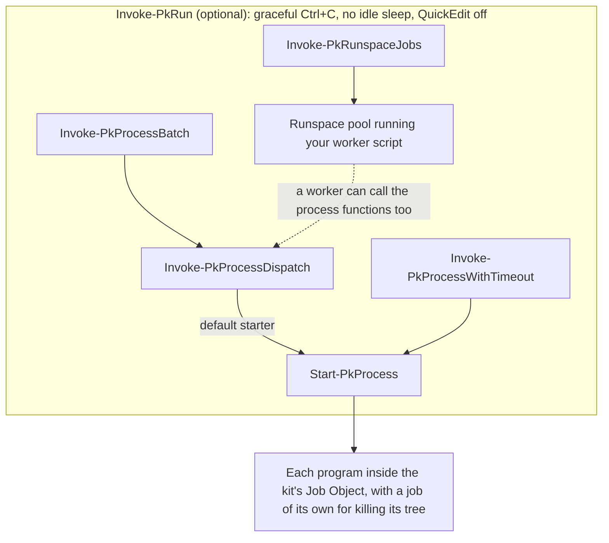
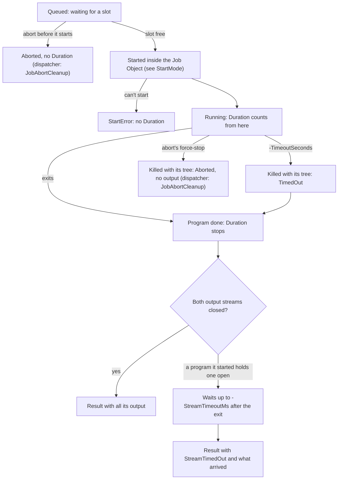

# ParallelKit

[](https://github.com/HalRiveria/PowerShell-ParallelKit/actions/workflows/tests.yml)

Run thousands of command-line programs, or blocks of PowerShell code, in parallel from Windows PowerShell 5.1 or PowerShell 7. One file, nothing to install.

Starting programs in parallel from PowerShell is easy. Stopping them is the hard part: Ctrl+C cuts work off mid-file, programs keep running after the script that started them dies, and reading a program's output the simple way can deadlock. ParallelKit handles those parts:

- **Programs run directly**, a set number at a time, with stdout and stderr read in the background so a full pipe can't deadlock, instead of a PowerShell thread tied up waiting on each one.
- **Graceful Ctrl+C with `Invoke-PkRun`.** No new work starts, running work gets time to finish (60 seconds by default), and then what's left is stopped and reported, with a cleanup call for each in the group dispatcher. Closing the window stops what's left right away, since Windows allows only a few seconds.
- **Process-tree cleanup.** In the normal `CreatedInJob` mode, each program is created inside a Windows Job Object. Windows then terminates it and its descendants when PowerShell exits, even if PowerShell is killed outright. The documented fallback modes have some limitations.
- **Runspace jobs with safety checks.** Run a PowerShell worker script many times in parallel. Before anything starts, the kit checks the worker code for the two mistakes that make runspace code hang, crash or quietly read nothing.
- **Work in groups.** A folder at a time, say, with retries or follow-up steps per file and a callback when each folder is done.

The kit is built to be reliable first and fast second. The aim is that a long run either finishes or stops cleanly, and that whatever goes wrong along the way is reported rather than lost. A program that can't start, runs past its time limit or holds its output open, a worker that crashes, or a Ctrl+C partway through: each is handled and shows up in what the call returns, instead of hanging or killing your script. Closing the window is the exception: Windows allows only a few seconds, so the kit stops the programs at once, and PowerShell closes with the window. The main harness exercises real programs and runspaces, with no mocked process execution. GitHub Actions runs it against Windows PowerShell 5.1 and PowerShell 7 on every pull request and every change to `main`. Additional targeted regression and stress suites are maintained under `Testing/` and can be run independently.

Developed with assistance from Claude Code. The implementation, test harness, and development history are available for inspection. I encourage independent review and testing.

**Contents:** [Process-tree cleanup limitations](#process-tree-cleanup-limitations) · [Quick start](#quick-start) · [Who it's for](#who-its-for) · [Which function](#which-function) · [Setup](#setup) · [How it fits together](#how-it-fits-together) · [Run a list of programs](#run-a-list-of-programs) · [Process results](#process-results) · [Run PowerShell code in parallel](#run-powershell-code-in-parallel) · [The two rules for worker code](#the-two-rules-for-worker-code) · [Process dispatch with groups](#process-dispatch-with-groups) · [Single processes](#single-processes) · [Messages](#messages) · [Abort](#abort) · [Choosing limits](#choosing-limits) · [Limits](#limits) · [Testing](#testing) · [FAQ](#faq) · [Not planned](#not-planned)

## Process-tree cleanup limitations

ParallelKit uses Windows Job Objects to clean up programs and their descendants. The following cases can prevent cleanup from reaching every process in a tree.

<details>
<summary>The three cases</summary>

- **`AddedToJob`.** Creating a program inside the Job Object relies on a private part of .NET. Where the kit can't do that, it starts the program and adds it to the Job Object just after, and warns once. A child the program starts in that moment can escape.
- **`NoJob`.** If Windows won't give the kit a Job Object at all, it warns, and programs left running when PowerShell is killed stay running.
- **Killing a program's tree** (a time limit, an abort's force-stop, `Stop-PkProcessTree`). A program the kit started is killed through a Job Object of its own, along with everything it started. One without that job (with `NoJob`, or where Windows refused it) goes to `taskkill /T` instead, and if `taskkill` can't start, fails or hangs, only the program itself is killed. Its children then run until PowerShell exits, or past that with `NoJob`.

</details>

## Quick start

Most uses are this: a list of command-line programs, run a few at a time, where Ctrl+C lets the running ones finish instead of cutting them off.

```powershell
# In a saved script. At the prompt, $PSScriptRoot is empty: use . .\ParallelKit.ps1 instead.
. "$PSScriptRoot\ParallelKit.ps1"

$commands = foreach ($f in Get-ChildItem *.png) {
    @{ FilePath = 'cjxl.exe'; Arguments = @($f.FullName, "$($f.FullName).jxl") }
}
$batch = Invoke-PkRun { Invoke-PkProcessBatch -Commands $commands -MaxConcurrent 6 }

foreach ($r in $batch.Results) {
    if ($r.Aborted) { continue }      # stopped by Ctrl+C before it finished; no exit code
    if ($r.StartError) { continue }   # couldn't start; the kit has already said why
    if ($r.ExitCode -ne 0) { Write-Warning ('Failed: ' + $r.Command.Arguments) }
}
```

That's all you need for this case. The worker rules, closures and callback details further down don't apply to it: they only matter for running PowerShell code in parallel (`Invoke-PkRunspaceJobs`) or for the group dispatcher. [Run a list of programs](#run-a-list-of-programs) covers the options, and [Process results](#process-results) what comes back.

## Who it's for

Scripts that have to run on Windows PowerShell 5.1, the version built into Windows 10 (1607 and later), Windows 11 and Windows Server 2016 and later. Usually that's because PowerShell 7 isn't installed or isn't allowed on the machines involved, or because the script has to run anywhere without asking anyone to install anything.

On PowerShell 7, `ForEach-Object -Parallel` is the simpler choice for plain parallel PowerShell code. For external programs the kit still adds things 7 doesn't do for you: programs run directly, without a runspace thread waiting on each one; Ctrl+C lets running ones finish before the rest are stopped, with a cleanup call for each; a time limit per program kills it and everything it started; they die with the script even if PowerShell is killed; and work can come in groups, with retries and a step when each group is done. The full test suite runs on 7 for every change.

The typical job is batch work over lots of files with a command-line tool: converting images, audio or video, compressing archives, running a check or build step per file. That's what the process side is built for, and it's where most of the kit's care has gone.

For plain parallel loops of PowerShell code, other tools are simpler. Reach for ParallelKit when you need any of these:

- Ctrl+C that lets running work finish instead of cutting it off mid-file.
- Child processes that are cleaned up even if the script is killed outright (with the exceptions under [Process-tree cleanup limitations](#process-tree-cleanup-limitations)).
- A cap on how many external programs run at once, with their output captured without risk of a full-pipe deadlock.
- Work that comes in groups (a folder at a time, say), with retries or follow-up steps per file and something to do when each group is finished.

<details>
<summary>Why not use something else?</summary>

For running PowerShell code in parallel, most of these are fine and some are simpler. ParallelKit is mainly about running external programs, and about what happens when a run is stopped partway through.

- **PowerShell 7's `ForEach-Object -Parallel`.** The easy answer for plain parallel PowerShell code if you can use PowerShell 7. For external programs, ParallelKit adds what it doesn't do: see [Who it's for](#who-its-for). `ForEach-Object -Parallel` also refuses a scriptblock passed by `$using:`, rather than letting it run where it isn't safe.
- **`Start-Job`.** Built in, but each job is a whole new `powershell.exe` process, so every job costs noticeable startup time and memory, and what it returns comes back as serialized copies (properties only, no methods). 5.1's `Start-Job` has no throttle either, so you write the wait-for-a-free-slot loop yourself. Fine for a handful of long jobs, poor for thousands of short ones.
- **ThreadJob (`Start-ThreadJob`).** Runs jobs as runspaces in the same process, with a `-ThrottleLimit`. On 5.1 it's the best fit for plain parallel scriptblocks, if you can install a module from the PowerShell Gallery (`Microsoft.PowerShell.ThreadJob`; it ships with PowerShell 7, not 5.1).
- **PoshRSJob (`Start-RSJob`).** A community module from the Gallery, also runspace-based, with a `-Throttle` limit and a job-style interface. It hasn't had a release since 2018, it can report a job as Completed before its output is ready (run `Wait-RSJob` before `Receive-RSJob`), and it's hit harder than ThreadJob by the [scriptblock problem](#faq). Where both are an option, ThreadJob is the better pick.
- **A runspace pool by hand** (`[runspacefactory]::CreateRunspacePool`). That's what `Invoke-PkRunspaceJobs` is built on. It works, but you end up writing the polling loop, error collection, cancellation and cleanup yourself, which is most of what this file is.
- **Workflows (`foreach -parallel`).** Still in 5.1, but they use a restricted version of the language, start slowly, and were dropped from PowerShell 6 and later. Not worth starting anything new on.
- **`Start-Process` in a loop.** Starts programs without waiting, but can only send their output to files, and the throttling and waiting are up to you. Using `System.Diagnostics.Process` directly gets output into memory, but reading stdout and then stderr the simple way deadlocks once a program fills the pipe you aren't reading. The kit reads both in the background.
- **`Invoke-Command -AsJob` against localhost.** Needs PowerShell remoting enabled (on by default only on Windows Server), and connecting to your own machine needs an elevated session, all for no gain on one machine.

</details>

## Which function

The kit's public functions, by what they're for. Everything else in the file is an internal helper that stays inside the module and can change between versions.

| Function | What it's for |
|---|---|
| **Engines** | |
| `Invoke-PkProcessBatch` | Run a flat list of external programs, a set number at a time, and get one result per command. |
| `Invoke-PkProcessDispatch` | Run programs that come in groups, with retries or follow-up jobs and a callback when each group is done. |
| `Invoke-PkRunspaceJobs` | Run a PowerShell worker script many times in parallel, in runspaces. |
| `Invoke-PkRun` | Wrap any of the above for graceful Ctrl+C: running work finishes before the rest is stopped. |
| **One program** | |
| `Invoke-PkProcessWithTimeout` | Run one program and wait for it, with a hard time limit. |
| `Start-PkProcess` | Start one program hidden, with its output read in the background, and return at once. |
| `Wait-PkProcess` | Wait for a started program to exit, with a timeout that can't overrun. |
| `Complete-PkProcess` | Collect a finished program's exit code and output. |
| `Stop-PkProcessTree` | Kill one or more programs and everything they started. |
| `ConvertTo-PkArgumentString` | Join a list of arguments into one correctly quoted command line. |
| **Abort and cancellation** | |
| `Test-PkAbortSignal` | Main thread: has an abort (Ctrl+C, window close, `Request-PkAbort`) started? |
| `Test-PkCancelRequested` | Worker code: is this run being canceled or aborted? Check it before anything irreversible. |
| `Request-PkAbort` | Start an abort from code, the same as Ctrl+C. |
| `Reset-PkAbortState` | Clear a finished abort, to call an engine again outside `Invoke-PkRun`. |
| `Register-PkCancellationSource` | Add your own `CancellationTokenSource` to the set an abort cancels. |
| `Unregister-PkCancellationSource` | Take one back out. |
| `Get-PkAbortTriggerLabel` | Say what started the abort: Ctrl+C, Ctrl+Break, a window close or `Request-PkAbort`. |
| **Messages** | |
| `Write-PkMessage` | Write a message from anywhere, worker code included; it's delivered on the main thread. |
| `Set-PkMessageHandler` | Send the kit's messages, and yours, to your own logging. |
| **Setup and checks** | |
| `Initialize-ParallelKit` | Set up Ctrl+C handling and child-process cleanup up front, and report how it went. Optional. |
| `Test-PkWorkerSafety` | A static check for the common ways worker code breaks [the two rules](#the-two-rules-for-worker-code), for your own tests. It catches likely mistakes; it doesn't prove code safe. |

Each one has built-in help: `Get-Help Invoke-PkProcessBatch -Full` shows its parameters, their defaults, what it returns and an example. That's the parameter reference; this README explains how the pieces behave.

## Setup

Requires Windows, with Windows PowerShell 5.1 or PowerShell 7. Download `ParallelKit.ps1` from the [Releases page](https://github.com/HalRiveria/PowerShell-ParallelKit/releases) (this README describes version 3.4 and later), put it in your project, and dot-source it from your script:

```powershell
. "$PSScriptRoot\ParallelKit.ps1"
$pk = Initialize-ParallelKit   # optional; warns by itself if part of the setup fails
if ($pk.StartMode -eq 'NoJob') {
    # Only for a script that must not leave programs running if PowerShell is killed.
    # AddedToJob passes: it still cleans up, with the gaps under Process-tree cleanup limitations.
    throw 'ParallelKit has no Job Object here, so programs would outlive a killed script.'
}
```

If you downloaded the file, Windows marks it as coming from the internet and your execution policy may refuse to load it. Run `Unblock-File .\ParallelKit.ps1` once to clear that.

If your machines only run signed scripts (the `AllSigned` execution policy), the file has to be signed with a certificate they trust. The release copy isn't signed.

<details>
<summary>What Initialize-ParallelKit returns</summary>

`Initialize-ParallelKit` is optional. It registers the Ctrl+C handler and sets up child-process cleanup up front; the engines set up what they need on first use either way. The kit leaves the thread pool's settings alone. It returns an object with:

- `AbortHandler`: `$true` if the Ctrl+C handler was registered. A failure also prints a warning.
- `ChildProcessJob`: `$true` if the Job Object for child-process cleanup was set up. A failure also prints a warning, and is the same case as `StartMode` `NoJob`.
- `ThreadPool`: always `$true`, kept for scripts that check it.
- `Version`: the kit's version.
- `StartMode`: how the kit starts programs here. `CreatedInJob` (inside the Job Object, the normal case), `AddedToJob` (started, then added to it just after) or `NoJob` (no cleanup if PowerShell is killed). It's the default for the session, not a promise for every program: one whose start can't be set up inside the Job Object falls back to `AddedToJob`, with a warning. See [Process-tree cleanup limitations](#process-tree-cleanup-limitations).

</details>

<details>
<summary>How it loads</summary>

It works whether or not your script uses `Set-StrictMode`.

The version is in the comment block at the top of the file, so a copy kept in your project still says which one it is. That block also carries the license notice; keep it with the file.

Dot-source it. It loads itself as an in-memory module named `ParallelKit`: nothing is installed and nothing goes on `$env:PSModulePath`, but `Get-Module` lists it while it's loaded. Dot-sourcing it again replaces the copy already loaded.

Its public functions are imported globally, so they stay available for the rest of that PowerShell session, and a `.GetNewClosure()` block can call them however your script was started. Its internal helpers stay inside the module.

</details>

## How it fits together

Two engines do the work: the process side runs external programs, and `Invoke-PkRunspaceJobs` runs PowerShell code. `Invoke-PkRun` is an optional wrapper around either one that turns Ctrl+C into a graceful abort.



- `Invoke-PkProcessBatch` is a thin layer over the dispatcher: a flat list is one group. Both start programs through `Start-PkProcess` unless you give the dispatcher a starter of your own.
- Every program the kit starts goes into one Job Object, which Windows closes when PowerShell exits, killing whatever is still in it. Each program also gets a Job Object of its own, nested in that one, so a time limit or a force-stop kills it and everything it started at once.
- The runspace engine doesn't start programs itself, but worker code can call any of the process functions, the dispatcher included.
- All of them share one abort state (Ctrl+C, window close, `Request-PkAbort`) and one message handler. A worker's messages are queued and delivered on the main thread.

## Run a list of programs

`Invoke-PkProcessBatch` takes a list of commands, runs a set number at a time, and returns one result per command.

```powershell
# Any command-line tool works. cjxl is a JPEG XL image encoder.
$commands = foreach ($f in Get-ChildItem *.png) {
    @{ FilePath = 'cjxl.exe'; Arguments = @($f.FullName, "$($f.FullName).jxl"); Source = $f }
}
$batchParams = @{
    Commands       = $commands
    MaxConcurrent  = 6
    TimeoutSeconds = 300      # kill a program still running after 5 minutes
    MaxOutputChars = 100000   # keep at most this much of each program's stdout and stderr
    OnComplete     = {
        param($command, $result)
        if ($result.ExitCode -ne 0) { Write-PkMessage "FAILED: $($command.Source.Name)" -Level Error }
    }
}
$batch = Invoke-PkRun { Invoke-PkProcessBatch @batchParams }

# A summary at the end. -OnComplete only sees programs that ran; the results cover every command.
foreach ($r in $batch.Results | Where-Object { $_.StartError -or $_.TimedOut -or $_.Aborted -or $_.ExitCode -ne 0 }) {
    $why = if ($r.StartError) { "couldn't start: $($r.StartError)" }
           elseif ($r.TimedOut) { 'ran past its time limit' }
           elseif ($r.Aborted) { 'stopped by an abort' }
           else { "exit code $($r.ExitCode)" }
    Write-PkMessage "$($r.Command.Source.Name): $why" -Level Warn
}
```

Long parameter lists in these examples use splatting (`@batchParams`) instead of trailing backticks: it's easier to read, and a stray space after a backtick can't break it.

Each command is a hashtable with `FilePath`, `Arguments` and optionally `WorkingDirectory`, plus any keys of your own, which come back on its result. Programs run hidden, with their output captured. `-OnComplete` runs on the main thread as each command finishes. [Process results](#process-results) covers what comes back.

<details>
<summary>Arguments and quoting, cmd.exe and .bat files</summary>

`Arguments` is either one string, passed to the program exactly as written, or a list with one argument per element: `Arguments = @($in, $out)` works with spaces in the paths. With a list:

- The program gets exactly that list back, spaces, quotes and trailing backslashes included. Don't pre-quote elements: a quote inside one is passed on as a quote character.
- `$null` elements are left out, a file or folder object from `Get-ChildItem` or `Get-Item` is its full path, and an element that's itself a list is an error.
- The quoting follows the rules most Windows programs use. `cmd.exe` itself (`FilePath = 'cmd.exe'`, `Arguments = @('/d', '/c', 'tool.exe', $file)`) gets the batch-file quoting described next, and the program after `/c` gets the rest of the list as given. `cmd.exe` strips the quotes from a program path with spaces, though, so for one of those give it one string: `'/d /s /c ""C:\My Tools\tool.exe" "a b""'`.
- A `.bat` or `.cmd` program runs through `cmd.exe`, and the list is quoted for it: an element holding `&`, `|`, `<`, `>`, `^`, `(`, `)`, `,`, `;` or `"` reaches it as one argument and can't make `cmd.exe` run anything else. A `"` is written `""` for it, so the batch file itself sees the quote doubled in `%1` or `%~1`, while a program it passes `%*` on to gets the list back as given. An element with a line break is an error. What quoting can't stop: `cmd.exe` expands `%NAME%` when a variable by that name exists, and splits batch arguments at `=` (left unquoted, since some programs read `NAME=value` themselves). The batch file can also undo the quoting: `%~1` strips the quotes, so a line like `echo %~1` runs the `& echo INJECTED` in an element `a & echo INJECTED`. Keep it quoted in the batch file (`"%~1"`), or use `%1`.

Only the list form gets this quoting. A string, including one built with `ConvertTo-PkArgumentString`, is passed as written.

</details>

<details>
<summary>Where programs run and how they're found</summary>

Programs run in your current location (`Get-Location`) unless a command says otherwise, and a relative `WorkingDirectory`, or a `FilePath` with a folder in it like `.\tools\cjxl.exe`, is relative to that location too. Drives PowerShell knows, like `~` or one made with `New-PSDrive`, work in both. A bare name like `cjxl.exe` is found the way Windows finds programs, mostly on `PATH`. Only an `.exe` is found without its extension (Windows doesn't use `PATHEXT` here), so a `.cmd` wrapper such as `npm` has to be written out: `npm.cmd`. A `.bat` or `.cmd` program can't run in a network-share (`\\server\share`) folder: `cmd.exe` falls back to `C:\Windows` there, so give such commands a local `WorkingDirectory`.

</details>

<details>
<summary>Defaults, time limits and output caps</summary>

`-OnComplete` runs as each command finishes, but only for commands that actually ran. Check `Results` for the ones that couldn't start or were aborted. A progress counter driven from `-OnComplete` won't reach the total if any did, so count from `$batch.Results` afterwards for the final numbers. Defaults: `-MaxConcurrent` 4, `-AbortTimeoutSeconds` 60 (how long Ctrl+C waits for running programs), `-TimeoutSeconds` 0 (no limit). The runspace engine's names, `-MaxParallel` and `-DrainTimeoutSeconds`, work here too, and on the dispatcher.

`-TimeoutSeconds 600` kills any program still running after 10 minutes. Its result has `TimedOut = $true`, still goes through `-OnComplete`, and the rest of the batch carries on. The default, 0, means no limit. Any programs it started are killed with it. It can be fractional. A command's own `TimeoutSeconds` key overrides this for that command; 0 opts it out of the limit. A bad value there gives that command a `StartError`.

`-MaxOutputChars 100000` keeps at most 100,000 characters of each program's stdout and stderr. Past that, the first half and the last half are kept, so the start and the end of a long log are both there, and `StdoutDroppedChars` / `StderrDroppedChars` say how many characters were left out. The rest is still read, so the program never stalls on a full pipe. The default, 0, keeps everything. A command's own `MaxOutputChars` key overrides it; 0 opts that command out. `Start-PkProcess`, `Invoke-PkProcessWithTimeout` and the dispatcher take it too.

Both per-command keys go on the command itself, for example one that keeps all of its output and gets 30 seconds: `@{ FilePath = 'tool.exe'; Arguments = @('x'); MaxOutputChars = 0; TimeoutSeconds = 30 }`.

`-StreamTimeoutMs` (default 15000) is how long to wait for a program's output after it exits; see `StreamTimedOut` in [Process results](#process-results).

</details>

<details>
<summary>Output encoding</summary>

Output is decoded in the console's code page unless you say otherwise, which is right for Windows' own tools. Many cross-platform tools write UTF-8 instead, and their non-ASCII output (accented or Japanese file names, say) comes back garbled. Pass `-OutputEncoding 'utf-8'` for the whole batch, or put an `OutputEncoding` key on one command. It also takes a code page number (`65001`, `437`, or the same as a string, as read from a CSV or config file) or a `[System.Text.Encoding]`, and the same option exists on `Invoke-PkProcessWithTimeout` and `Start-PkProcess` (and as a job key for the dispatcher's default starter).

</details>

<details>
<summary>What Invoke-PkRun adds</summary>

`Invoke-PkRun { ... }` is what makes Ctrl+C graceful. Whatever the block outputs is passed through, so `$batch` above gets the batch result. It also stops the PC idle-sleeping until the run ends (`-KeepAwake $false` to opt out); the display can still turn off. Without `Invoke-PkRun` the engines still work, but Ctrl+C kills the script the normal way. See [Abort](#abort) for what it means for your own code inside the braces.

</details>

## Process results

`Invoke-PkProcessBatch` returns an object with `Results`, `Aborted` and `ForceKilledCount`. `Results` holds one object per command, with every field always present, so `$batch.Results | Format-Table` reads well. `Complete-PkProcess` and `Invoke-PkProcessWithTimeout` return the fields marked "all".

| Field | From | What it means |
|---|---|---|
| `Command` | batch | Your original command hashtable, so extra keys like `Source` above come back with it. |
| `ExitCode` | all | Whatever the program returned. `$null` for a command that never started or that an abort killed. |
| `Stdout`, `Stderr` | all | The program's output, as text. Can be partial: see `StreamTimedOut`, `TimedOut` and the dropped counts. `$null` for a command that never started or that an abort killed, and for a stream whose read failed. |
| `StartError` | batch | Why the program couldn't be started (not found, say). Every command is still tried and gets its own result, but repeats of the same failure for the same program print once, with a count at the end. |
| `Aborted` | batch | `$true` for a command an abort killed or kept from starting. |
| `TimedOut` | batch | `$true` for a program `-TimeoutSeconds` killed. The dispatcher sets `$job['TimedOut']` instead. |
| `Duration` | all | How long the program ran, from its start to its exit or kill, as a `[TimeSpan]`. `$null` for a command that never started. |
| `StreamTimedOut` | all | The output read gave up `-StreamTimeoutMs` after the program exited, because a program it started still held the output open. |
| `StreamError` | all | A read failed; that stream comes back `$null`. |
| `StdoutDroppedChars`, `StderrDroppedChars` | all | How many characters `-MaxOutputChars` left out of each stream; 0 when nothing was, or with no cap. |

Things that are easy to mix up:

- **A non-zero exit code isn't a kit failure.** The kit doesn't judge exit codes; that's for you to decide.
- **A stream timeout isn't a time limit.** `StreamTimedOut` means the program had already exited, but something it started kept its output open. `TimedOut` means the program itself ran past `-TimeoutSeconds` and was killed.
- **A time limit isn't an abort.** A timed-out command gets its exit code and the output it wrote, goes through `-OnComplete`, and the rest of the batch carries on. An aborted one has no exit code or output and skips `-OnComplete`.
- **A command that never started has no `Duration`.** That covers a `StartError` and a command an abort kept from starting.
- **`Duration` is the program's time, not the command's.** It leaves out the wait for a slot and any wait for output after the exit. Sorting on it finds the slow ones: `$batch.Results | Sort-Object Duration -Descending | Select-Object -First 10`.

`Results` is in the order commands finished, not the order you gave them. Use `Command` to match them up, or give each command your own key (`Index = $n`) and sort on it: `$batch.Results | Sort-Object { $_.Command.Index }`.

<details>
<summary>A program's lifecycle</summary>

A program can be done while its output isn't: whatever it started can hold its output open after it exits. This is the path one command takes:



During an abort's wait, running programs carry on as normal and end up with normal results. Only the ones still running when the wait ends, or when Ctrl+C is pressed again or the window closes, are force-stopped.

</details>

<details>
<summary>When output is held open (StreamTimedOut in detail)</summary>

`StreamTimedOut` means the output read gave up 15 seconds after the program exited (`-StreamTimeoutMs` changes that, in milliseconds; 0 doesn't wait), on stdout, stderr or both, which only happens when a program it started is still holding the output open. Each stream comes back with what arrived before then: one held open is cut short, the other is whole.

The read of a held stream carries on in the background until that program lets go of it; it's in the kit's Job Object, so that's when PowerShell exits at the latest. Until then that read keeps a thread of its own, one per held stream, so other programs' output isn't held up behind it, and drops what it reads, so a program that keeps writing doesn't fill memory with output nobody can get. What came back is that stream's text from then on, so calling `Complete-PkProcess` again on the same job returns the same text, and so does the read task's `Result` once the stream ends.

`StreamError` means a read failed, and that stream comes back `$null`; it can be set alongside `StreamTimedOut` when the other stream was held open.

While a program's output is held open, its command keeps its slot, but the other commands carry on: they keep starting, finishing and being killed at their time limits, and an abort is acted on at once. If an abort's wait for running programs ends while one is still waiting for its output, it gets what has arrived, with `StreamTimedOut`, rather than counting as force-stopped.

</details>

## Run PowerShell code in parallel

`Invoke-PkRunspaceJobs` runs a worker script once per job, a set number at a time, and hands what each one returns to your result handler on the main thread.

```powershell
# Worker code can use cmdlets - see "The two rules" below for what it can't do.
function Get-FileSha {
    param([string]$Path)
    return (Get-FileHash -LiteralPath $Path -Algorithm SHA256).Hash
}

$jobs = [System.Collections.Generic.List[hashtable]]::new()
foreach ($f in Get-ChildItem -File) { $jobs.Add(@{ Path = $f.FullName }) }
$shaByPath = @{}

$jobsParams = @{
    MaxParallel         = 4
    JobParams           = $jobs
    SharedFunctionNames = @('Get-FileSha')
    WorkerScript        = {
        param([string]$Path)
        if (Test-PkCancelRequested) { return }
        Write-PkMessage "hashing $Path"
        return @{ Path = $Path; Sha = (Get-FileSha -Path $Path) }
    }
    ResultHandler       = { param($r) $shaByPath[$r.Path] = $r.Sha }.GetNewClosure()
}
$out = Invoke-PkRun { Invoke-PkRunspaceJobs @jobsParams }
```

Each worker runs in its own runspace: a separate PowerShell session inside the same process, with its own variables and functions. That separation is what makes running them at the same time safe, and also why a worker can't see your script's variables or functions unless you hand them over. Read [the two rules for worker code](#the-two-rules-for-worker-code) before writing one.

<details>
<summary>Jobs, parameters and shared functions</summary>

- Each job hashtable's keys become the worker's parameters. The worker's `param()` block must declare every key, and every job must supply each parameter it makes `[Parameter(Mandatory)]` (`CancelToken` aside, which is filled in). Either mistake is an error; with a fixed `-JobParams` list it's caught before any worker starts, and a `-NextJobProvider` job is checked as it arrives. A worker with parameter sets isn't checked for mandatory ones, since what it needs depends on the set.
- If the worker declares a `$CancelToken` parameter, it gets the run's cancellation token.
- `-JobParams` takes a list or array of job hashtables. A single hashtable works too, so a list that happens to hold one job is fine.
- A worker runspace starts empty. Name every one of your functions it calls in `-SharedFunctionNames`. The kit's own worker functions are always there, and cmdlets and functions from installed modules load on their own. A module you imported by path isn't installed, so list its functions too (or put it on `$env:PSModulePath`).
- Each job starts in your current location (the real folder, if you're on a `New-PSDrive` drive), in a fresh scope. A folder change or a variable one job makes, preference variables like `$ErrorActionPreference` included, doesn't carry over to the next job. Relative paths in .NET calls such as `[System.IO.File]::ReadAllText('x.txt')` still go by the process's working directory, as they do outside workers, so give .NET full paths.
- `-MaxParallel` has no default; you choose it. `-DrainTimeoutSeconds` (how long Ctrl+C waits for running workers) defaults to 60. The process engines' names, `-MaxConcurrent` and `-AbortTimeoutSeconds`, work here too.

</details>

<details>
<summary>Results, callbacks and lazy jobs</summary>

- Whatever the worker returns is handed to `-ResultHandler` on the main thread, once per object returned, in the order workers finish. Return something that identifies the job with each result, as the example's `Path` does.
- `-NextJobProvider { ... }` can replace `-JobParams` to produce jobs lazily: it's called on the main thread for the next job hashtable, and returns `$null` when there are no more. Each call outputs one job or `$null`, and nothing else. Only the last value counts: if it's `$null` the run ends, otherwise the last hashtable is the job. Anything else is ignored, with a warning.
- `-PollCallback { ... }` runs on the main thread on every loop pass, for progress display and the like. That's at least every 0.1 s, and can be many times more often when jobs finish quickly, so keep it cheap.
- If `-ResultHandler`, `-PollCallback` or `-NextJobProvider` throws, the run stops: workers still going are told to stop and the exception comes out of the call.
- Returns an object with `ForceStoppedCount`, `CrashedCount`, `Aborted`, `Crashed` and `Errors`. `ForceStoppedCount` is how many workers an abort stopped waiting for; one stuck in a .NET call keeps running (see [Limits](#limits)). `Crashed` lists the `Job` and `Error` of each worker that threw. `Errors` lists the `Job` and `Error` of each non-terminating error a worker wrote, including any written before it threw. A force-stopped worker is in neither list. Every entry is kept until the call returns, so a worker that can write thousands of errors (walking a tree of folders it can't read, say) should handle them itself, e.g. with `-ErrorAction SilentlyContinue -ErrorVariable`.

</details>

<details>
<summary>Errors and crashed workers</summary>

- `-JobCrashedHandler { param($err, $job) ... }` is told when a worker throws, including while an abort waits for running workers, with the job hashtable that crashed. Leave `$job` out of `param()` if you don't need it. `$err.Exception.InnerException` is the worker's own error. That job's result handler isn't called, and anything the worker output before throwing is lost. If the handler itself throws, that's reported as a message and the run carries on.
- Only an error that stops the worker counts as a crash: `throw`, a cmdlet with `-ErrorAction Stop`, or any error once the worker sets `$ErrorActionPreference = 'Stop'`. On 5.1, though, functions from script modules only see a preference set at the top level of a script, and a worker always runs in a scope of its own. `Get-FileHash` is one of those functions on 5.1 (it's a compiled cmdlet on 7), so give it, and commands like it, `-ErrorAction Stop` as well. A non-terminating error (a locked file in `Get-FileHash`, a `Write-Error`), or an exception from a .NET method such as `[System.IO.File]::ReadAllText(...)`, only ends that one statement. It's printed as `Runspace error: ...` and recorded in the result's `Errors` list with its job, and whatever the worker returned still goes to `-ResultHandler` as if it had worked. Workers start with PowerShell's default preferences and no strict mode, whatever your script uses. To catch every failure and know which input it came from, have the worker return its own error object:

  ```powershell
  WorkerScript = {
      param($Path)
      $ErrorActionPreference = 'Stop'
      try   { [pscustomobject]@{ Path = $Path; Hash = (Get-FileHash -LiteralPath $Path -ErrorAction Stop).Hash; Error = $null } }
      catch { [pscustomobject]@{ Path = $Path; Hash = $null; Error = $_.Exception.Message } }
  }
  ```
- Don't call `exit` in a worker. It ends that job quietly (not as a crash) and sets your whole script's exit code.

</details>

## The two rules for worker code

These only apply if you run PowerShell code in parallel with `Invoke-PkRunspaceJobs` (or call a dispatcher from inside one of its workers). Running external programs with `Invoke-PkProcessBatch` or `Invoke-PkProcessDispatch` on the main thread never touches them.

Worker code is the worker script, every function in `-SharedFunctionNames`, and anything they call. Breaking these rules doesn't fail loudly. It hangs, crashes, or quietly reads nothing.

1. **No `$script:` variables.** In a worker they can silently read as empty. Pass state in as job parameters. (`$script:` at the very top level of the worker script is fine; inside a function or a nested `{ }` block it isn't.)
2. **A scriptblock only runs in the runspace that made it.** Don't hand one to .NET as a delegate (`[Func[...]]{ }`, `[Action]{ }`, a `System.Lazy` factory, `ConcurrentDictionary.GetOrAdd($k, { })`, a comparer, an event or task callback): use plain loops and `[System.Threading.Monitor]` instead. Don't pass one in as a job value either: pass its text (`$sb.ToString()`) and rebuild it in the worker with `[scriptblock]::Create($text)`.

Everything else is fine in a worker, cmdlets included. Callbacks that run on the main thread (`-ResultHandler`, `-PollCallback`, `-NextJobProvider`, `-OnComplete`, the message handler) are not worker code and can use anything.

<details>
<summary>How the kit checks them</summary>

`Invoke-PkRunspaceJobs` checks both rules before it starts anything, and refuses to launch code that breaks them, naming the line or the job key. Pass `-CheckWorkerSafety:$false` to turn that off. The code check is also available on its own as `Test-PkWorkerSafety -WorkerScript $w -SharedFunctionNames $names`, which returns a list of findings (including functions the worker calls but you didn't share), for use in your own tests. For rule 2 it flags written casts, and scriptblocks passed into a .NET method or constructor, either written in the call or through a variable they were assigned to. `# pk:ignore` on a line accepts a finding. Storing a scriptblock in a collection (`$list.Add($sb)`, `$queue.Enqueue($sb)`) isn't flagged, since that makes no delegate. It can't see commands run through a variable (`& $cmd`), a collection typed to hold delegates (`List[Func[object]]`, whose `.Add` converts), or a scriptblock buried more than three levels deep in a job value.

</details>

<details>
<summary>Why these rules exist</summary>

Both were found chasing real, intermittent failures, and neither is in Microsoft's documentation as far as we could find.

- **`$script:` variables.** A function listed in `-SharedFunctionNames` is recreated inside the worker from its source text, so it's no longer attached to your script and its `$script:` points somewhere else. Inside a `.GetNewClosure()` block, `$script:` points at a private copy. Either way the read comes back empty, with no error.
- **Scriptblocks.** A scriptblock belongs to the runspace that created it, and runs against that runspace's session state wherever it's called from ([PowerShell issue #4003](https://github.com/PowerShell/PowerShell/issues/4003)). When a delegate makes .NET call one from another runspace's thread, PowerShell can hand the call back to the owning runspace's thread. If that thread is itself waiting, and the scriptblock runs another scriptblock inside it (a `Where-Object { }` filter, a nested delegate), it deadlocks. Even when it doesn't deadlock, two threads using one session state at once can crash the process. A scriptblock passed in as a job value is the same case: in stress tests, 8 workers running one passed from the main thread broke 88 of 90 runs, usually by corrupting the main thread's session state so the kit's own functions vanished mid-run, even when the scriptblock held nothing but .NET calls. Passed as text and rebuilt in the worker, the same code ran clean in all 30 runs.

</details>

## Process dispatch with groups

`Invoke-PkProcessBatch` covers a flat list. `Invoke-PkProcessDispatch` is the engine under it, for work that comes in groups (a folder of files, say) where something should happen when each group finishes. This example converts each subfolder's PNGs to lossless JPEG XL, retries a failed file once, and zips each folder whose files all converted:

```powershell
. "$PSScriptRoot\ParallelKit.ps1"

# One group per subfolder of D:\Scans: convert its PNGs to lossless JPEG XL, then zip each finished folder.
$folders = [System.Collections.Generic.Queue[object]]::new()
foreach ($d in Get-ChildItem -LiteralPath 'D:\Scans' -Directory) { $folders.Enqueue($d) }
$failed = @{}   # folder path -> how many of its files didn't convert

$dispatchParams = @{
    MaxConcurrent = 6
    GroupProvider = {
        # The next folder, or $null when there are none left. Called as the run needs more work, a few folders ahead.
        if ($folders.Count -eq 0) { return $null }
        return $folders.Dequeue()
    }
    JobBuilder = {
        param($folder)
        # One job per PNG. A folder's files are listed only when its turn comes.
        $failed[$folder.FullName] = 0
        foreach ($f in Get-ChildItem -LiteralPath $folder.FullName -Filter *.png -File) {
            $out = [System.IO.Path]::ChangeExtension($f.FullName, '.jxl')
            @{ FilePath = 'cjxl.exe'; Arguments = @($f.FullName, $out, '-d', '0'); Out = $out; Tries = 1 }
        }
    }
    JobFinalize = {
        param($job, $pending)
        $r = Complete-PkProcess -Job $job
        if ($r.ExitCode -eq 0) { return }
        if ($job.Tries -lt 2) {
            # A follow-up job: one more try. It joins the same folder, which isn't complete until it's done.
            $pending.Enqueue(@{ FilePath = $job.FilePath; Arguments = $job.Arguments; Out = $job.Out; Tries = $job.Tries + 1 })
            return
        }
        $failed[$job.Group.FullName]++
        Write-PkMessage "FAILED: $($job.Out)" -Level Error
    }
    JobAbortCleanup = {
        param($job)
        # An abort killed this conversion, or kept it from starting. Only one that started can have left a partial file.
        if ($null -ne $job.Proc) { Remove-Item -LiteralPath $job.Out -ErrorAction SilentlyContinue }
    }
    GroupCompleteCallback = {
        param($folder)
        # Also runs for a folder an abort cut short: don't zip a partial set.
        if ((Test-PkCancelRequested) -or $failed[$folder.FullName] -gt 0) { return }
        $converted = @(Get-ChildItem -LiteralPath $folder.FullName -Filter *.jxl -File)
        if ($converted.Count -gt 0) {
            Compress-Archive -LiteralPath $converted.FullName -DestinationPath "$($folder.FullName).zip" -Force
        }
    }
}
$dispatch = Invoke-PkRun { Invoke-PkProcessDispatch @dispatchParams }

foreach ($g in $dispatch.GroupResults) {
    if ($g.Aborted) { Write-Warning "$($g.GroupInfo.Name): cut short by Ctrl+C, not zipped" }
    elseif ($failed[$g.GroupInfo.FullName] -gt 0) { Write-Warning "$($g.GroupInfo.Name): $($failed[$g.GroupInfo.FullName]) file(s) failed, not zipped" }
}
```

All of these callbacks run on whichever thread called the dispatcher: the main thread normally, or the worker if you call it from inside a runspace job (in which case the worker rules apply to them). The dispatcher returns an object with `GroupResults`, `Aborted`, `ForceKilledCount` and `JobStarterFailedCount`. `GroupResults` holds one object with `GroupInfo`, `Completed` and `Aborted` per group, where `GroupInfo` is the group value.

<details>
<summary>Groups and the group provider</summary>

- **`-GroupCompleteCallback` also runs for a group an abort cut short**, so you can record the jobs in it that did finish. Before doing anything irreversible there (zipping the folder, deleting sources), check `Test-PkCancelRequested` (or your own `-CancelToken`) and skip it if true.
- Groups are pulled lazily, at most `-MaxQueueAhead` (default 3) ahead.
- A group can be any value: a hashtable, a path, a name. Each job gets its group as `$job.Group`.
- Each `-GroupProvider` call outputs exactly one group, or `$null` to end, and nothing else: `return $group`, `return ,@('a', 'b', 'c')` for a list as one group (the comma keeps a one-item list a list), or `return $null`. Anything else it lets out (an `ArrayList.Add` index, say) becomes part of the group, so discard it with `$null = ...`. Output that ends in `$null` is taken as the end, with a warning, so a list group can't end in `$null`.
- `-GroupReleaseCheck { param($group) }` makes a group with zero jobs keep its queue-ahead slot until the check returns true. Use it to stop one dispatcher racing ahead of another that it's paired with. The dispatcher doesn't return until every held group has been released, unless the run is canceled or aborted. It runs on every loop pass, so keep it cheap. Only its last output value counts, so a stray value written before the answer doesn't release the group.

</details>

<details>
<summary>Jobs: finalizing, retries, time limits and reserved names</summary>

- `-JobFinalize` is called once per finished job. Collect its exit code and output there with `Complete-PkProcess -Job $job`; the dispatcher disposes the process right after.
  - **When a job counts as finished** (with the default `-JobPollCompleted`): once its program has exited and its output has been read.
  - **When the output is held open** by a program it started: the job counts as finished `-StreamTimeoutMs` after the exit (15 seconds by default). It keeps its slot until then, and the other jobs carry on.
  - **`Complete-PkProcess` in `-JobFinalize`** has nothing left to wait for, so it returns at once. Given no `-StreamTimeoutMs` of its own, it uses the dispatcher's. A longer one there waits only the difference, but on the dispatch loop's own thread, holding up the other jobs. To wait less, set the dispatcher's `-StreamTimeoutMs` instead.
  - **With your own `-JobPollCompleted`**, none of this applies: `Complete-PkProcess` waits as it does anywhere else.
- To retry a job or add follow-up work, enqueue job hashtables onto `$pending` inside `-JobFinalize`. They join the same group, and the group isn't complete until they've all finished. A retry can start within milliseconds of the failure, so cap the number of retries, and don't count on the gap for something like a locked file to clear.
- `-JobAbortCleanup { param($job) }` is called for each job an abort killed or kept from starting, to remove its partial output.
- `-TimeoutSeconds 600` kills a job's program, and anything it started, if it's still running after 10 minutes. The default, 0, means no limit, and it can be fractional. A job's own `TimeoutSeconds` key overrides it; 0 opts the job out, and a bad value is a failed start. `-MaxOutputChars` works the same way, with a job's `MaxOutputChars` key, for the default starter. The killed job still goes through `-JobFinalize`, where `$job['TimedOut']` is `$true`, and other jobs carry on. The limit stays in force while an abort waits for running jobs. A retry gets a fresh clock. A job whose `.Proc` isn't a process isn't timed: `-JobPollCompleted` is the place for its limit.
- The dispatcher keeps its state on the job hashtables. Don't use these names for your own job fields: `GroupKey`, `SlotReleased`, `Proc`, `StdoutTask`, `StderrTask`, `Stopwatch`, `TimeLimit`, `TimedOut`, `StartFailureReported`, `OutputWait`, `OutputWaitOver`, `OutputWaitMs`. (`Group` is yours if you set it yourself.)

</details>

<details>
<summary>Custom starters, polling and sharing a limit</summary>

- Supply `-JobStarter { param($job) ... }` to start jobs yourself. It must set `$job.Proc` and should return the job. A starter that is just `Start-PkProcess ...` works too: its result is folded into your job. Throw to report a job that couldn't start.
- `-JobPollCompleted { param($job) }` replaces the default "has the process exited" check. Use it for a custom starter whose job isn't a plain process. Only its last output value counts, so a stray value written before the answer doesn't mark the job done.
- `-PollCallback { param($runningJobs) }` runs on every loop pass, with the jobs currently running (`-AbortPollCallback`, its name before 3.0, also works). That's about every 50 ms, and can be many times more often when programs finish quickly, so keep it cheap.
- `-MaxConcurrent` can be a `SemaphoreSlim` shared by several dispatchers that must stay under one combined limit. It works inside workers, so two runspace jobs can each run a dispatcher against one shared budget.
- `-CancelToken` stops the dispatcher when canceled. An abort stops it either way, without canceling your token.
- Whatever your callbacks output is thrown away, apart from the return values listed here. Where a callback returns something, output only that: `-JobPollCompleted` and `-GroupReleaseCheck` go by their last value and `-JobBuilder` ignores anything that isn't a job hashtable, but a stray value from `-GroupProvider` becomes part of the group.
- An exception from one of your callbacks stops the dispatcher: running processes are killed and the exception is rethrown.

</details>

<details>
<summary>What callbacks can see, and leaving one early</summary>

A plain `{ ... }` callback sees your variables and functions from where you called the kit, not the kit's internals, so `.GetNewClosure()` isn't needed for that, inside a worker runspace or out. The one exception is inside a worker, where it can also see the kit's own variables, which all start with `pk`, so don't give yours names starting with `pk`. Keep any state a callback changes in a hashtable (`$state = @{ Count = 0 }`, then `$state.Count++`). A plain variable assigned inside a callback doesn't stick between calls. A `.GetNewClosure()` block can't see functions your script defines when the script is run from a prompt (`.\script.ps1`); the kit's own functions always work, but define any of yours that a closure calls as `function global:Get-Thing { ... }`.

To leave any callback early, use `return`. PowerShell sends a `continue` or `break` to the nearest loop, which for a callback is one of the kit's own, so the kit catches them and treats them as `return`, with a warning (once per callback per call, or once per message handler). A labeled `break` to a loop of yours (`break outer`) does leave the kit's call: it stops there, kills the programs it started and returns nothing.

</details>

## Single processes

For one program at a time, outside the engines. All of these are safe in worker code.

| Function | Use |
|---|---|
| `Invoke-PkProcessWithTimeout -FilePath -Arguments -TimeoutMs` | Run one program and wait, with a hard time limit (default 60s). Returns the [process result](#process-results) fields marked "all". If it overruns, or the run is aborted, the program is killed and this **throws**; add `-IgnoreAbort` for a cleanup step that must finish anyway. |
| `ConvertTo-PkArgumentString @(args)` | Join a list of arguments into one correctly quoted command line. `-Arguments` / `Arguments` also take the list directly, and then also quote it for `cmd.exe` when the program is a `.bat` or `.cmd`. |
| `Start-PkProcess -FilePath -Arguments` | Start one hidden, with output captured in the background. Returns `@{ Proc; StdoutTask; StderrTask; Stopwatch }`; throws if it can't start. |
| `Wait-PkProcess -Process -TimeoutMs` | Wait for exit with a timeout that can't overrun. Returns `$true` if it exited. |
| `Complete-PkProcess -Job` | Collect exit code and output from a finished one (`-Job` is what `Start-PkProcess` returned). Same result as `Invoke-PkProcessWithTimeout`. |
| `Stop-PkProcessTree -Process` | Kill one or more programs and every program they started. A program the kit started is killed through its own Job Object, which also reaches a child whose parent has already exited; anything else goes to `taskkill /T` (as few calls as Windows' command-line limit allows), and if `taskkill` can't start, fails or hangs, only the listed programs are killed. For one program, returns `$true` if it killed it (even if part of its tree couldn't be) and `$false` if it had already exited. See [Process-tree cleanup limitations](#process-tree-cleanup-limitations). |

`Invoke-PkProcessWithTimeout` and `Start-PkProcess` also take `-WorkingDirectory`. Wrapped in `Invoke-PkRun`, `Invoke-PkProcessWithTimeout` makes Ctrl+C kill the program and throw, instead of the whole script dying.

## Messages

Workers can't safely write to the console. `Write-PkMessage "text" -Level Info|Warn|Error` works from anywhere: in a worker it's queued and delivered on the main thread. `-Level Warning` also works and arrives as `Warn`; any other level is an error. By default messages go to `Write-Host`. To route them into your own logging:

```powershell
Set-PkMessageHandler { param($Message, $Level) Write-MyLog $Message $Level }
```

The handler always runs on the main thread, so it can use anything. The kit's own notices (abort announcements, crashed workers, force-stops) go through the same handler. If your handler throws, the message is shown on the console instead and the run carries on. `Set-PkMessageHandler $null` restores the default.

## Abort

Inside `Invoke-PkRun { ... }`, Ctrl+C:

1. stops new jobs from starting,
2. cancels the run's token (`Test-PkCancelRequested` turns true in workers),
3. waits for in-flight work (`-AbortTimeoutSeconds`, default 60; every engine also takes it as `-DrainTimeoutSeconds`),
4. force-stops whatever is left. The batch marks each killed or never-started command's result `Aborted`; the group dispatcher calls `-JobAbortCleanup` for each such job.

Press Ctrl+C again to skip step 3: whatever is still running is force-stopped right away, and your script carries on. A third press stops the script the way Ctrl+C normally does, and the kit's engines still kill the programs they started. Presses less than a second apart count as one, and Ctrl+Break works the same as Ctrl+C.

Closing the window does the same minus step 3: Windows allows only a few seconds, so leftovers are stopped right away.

Three things to know:

- **Inside `Invoke-PkRun`, Ctrl+C no longer kills anything by itself.** It only raises a flag. The kit's engines watch that flag. A long step of your own in there has to check `Test-PkAbortSignal` now and then and stop when it's true, or Ctrl+C will seem to do nothing until that step ends.
- **An abort stays in force until it's reset.** `Invoke-PkRun` resets it at the start of each run. If you call an engine again outside `Invoke-PkRun` after an abort, it returns right away with `Aborted = $true`. Call `Reset-PkAbortState` first if you mean to carry on.
- **Your script carries on after an abort.** The engines return with `Aborted = $true` and the rest of your script runs. If an abort should end it, say so: `if ($batch.Aborted) { exit 1 }`.

<details>
<summary>QuickEdit, and the other abort functions</summary>

`Invoke-PkRun` also turns off the console's QuickEdit mode for the length of the run (`-DisableQuickEdit $false` to opt out). With QuickEdit on in the classic console window, one stray click starts a text selection, and the script freezes at its next console write until the selection is cleared. That looks exactly like a hang. It's turned back on afterwards if it was on before.

Other pieces: `Request-PkAbort` triggers the same abort from code. `Test-PkAbortSignal` asks whether one is under way. `Register-PkCancellationSource` adds your own `CancellationTokenSource` to the set an abort cancels, and `Unregister-PkCancellationSource` takes it back out (a `-Cts` you pass to `Invoke-PkRunspaceJobs` is added automatically; a `-CancelToken` you pass to the dispatcher isn't canceled by an abort, but the dispatcher stops either way). `Get-PkAbortTriggerLabel` says which kind of abort it was.

</details>

## Choosing limits

- **`-MaxConcurrent` for programs.** For programs that use one CPU core each, start at `[Environment]::ProcessorCount`. Many encoders (image, video, compression) already use several cores per file, so fewer copies at once is often as fast and uses less memory. Programs that mostly wait on disk or network can go higher. Try a few values on real work; the best number depends on the tool.
- **`-MaxParallel` for runspace jobs.** Same idea: the core count for CPU-heavy PowerShell work. Each runspace costs some memory and startup time, so very high values rarely help.
- **Several dispatchers at once** (for example, one per runspace job) should share one `SemaphoreSlim` as `-MaxConcurrent`, so their combined total stays under the limit you picked. They take turns: each pauses up to 50 ms after a program finishes so the others can get the free slot, which costs very short programs some speed compared with a dispatcher of their own.

## Limits

- Windows only (console and Job Object APIs), on Windows PowerShell 5.1 or PowerShell 7.
- Run it in a PowerShell console window or an editor's terminal (graceful Ctrl+C tested in Windows Terminal, Visual Studio's built-in terminal and VS Code's terminal, including the PowerShell extension's). The Windows PowerShell ISE isn't supported: tested there, the kit loads and runs, but the ISE has no console, so Ctrl+C stops the script outright, with no graceful drain and no cleanup callbacks.
- It needs FullLanguage mode, since it compiles a little C# with `Add-Type` when loaded. On a machine locked down to Constrained Language Mode (usually by AppLocker or Windows Defender Application Control), loading it fails with a message saying so. Some endpoint security products also flag scripts that compile code calling Windows APIs at runtime; if yours blocks the kit, that's the likely reason.
- After changing `ParallelKit.ps1` itself, start a new PowerShell window. A session keeps the kit's compiled parts until it closes; the kit tells you if it finds an older copy loaded.
- One `Invoke-PkRun` at a time per PowerShell process: a call made while one is already running, nested or from another runspace, just runs inside it. Several dispatchers can run at once inside one run (one per runspace job, say); they share its abort state and can share a `SemaphoreSlim` to enforce a combined concurrency limit.
- A worker stuck inside a long .NET call can't be interrupted. Force-stop stops waiting for it and returns. The worker is NOT killed: once that call returns it can carry on to the end of its script. Before any step that can't be undone (deleting a source file, say), have the worker check `Test-PkCancelRequested` and skip the step if it's true.
- Programs run hidden, and there's no way to send them input. A program that stops to ask a question will sit there until it's killed.
- A program's output is collected in memory and handed over when it exits; there's no live line-by-line output. A program that prints gigabytes will use that much memory, unless `-MaxOutputChars` caps what's kept. A batch keeps every result, output included, until it returns, which adds up over thousands of chatty programs. If you only need the output in `-OnComplete`, drop it there with `$result.Stdout = $null; $result.Stderr = $null` and it's freed as the batch goes.
- Child-process cleanup has the gaps listed under [Process-tree cleanup limitations](#process-tree-cleanup-limitations).

## Testing

`ParallelKit.Harness.ps1` is the test suite. It isn't needed at runtime. It uses real runspaces and real child processes (`cmd.exe`, `ping.exe`), with nothing mocked. Run it in a fresh window (see [Limits](#limits)):

```powershell
powershell -NoProfile -File .\ParallelKit.Harness.ps1
```

<details>
<summary>What it prints, and the stress tests in Testing/</summary>

It takes about four and a half minutes. It prints a `[PASS]`/`[FAIL]` line per check and exits 0 only if everything passed. A few checks send real Ctrl+C, Ctrl+Break and window-close events to child PowerShell processes in hidden consoles of their own, never to yours. Where a machine can't deliver those, they print `[SKIP]` with the reason instead; set `PK_HARNESS_NO_SKIP=1` to count skips as failures. A few `message handler failed` lines in the output are expected: some checks break the message handler on purpose to test the fallback.

GitHub runs the same harness on Windows PowerShell 5.1 and on PowerShell 7 for every pull request and every change to `main`. The harness is the only test GitHub runs: the scripts in `Testing/` below are run by hand.

`Testing/` holds the longer stress tests and checks behind some of what this README says. They aren't part of the test suite and aren't needed to use the kit:

- `Testing/cmdlet-hang/` stresses the kit's worker code, for the [two rules](#the-two-rules-for-worker-code).
- `Testing/third-party/` asks the same question of ThreadJob and PoshRSJob. `results/matrix.log` holds the results behind the FAQ answer, from `Microsoft.PowerShell.ThreadJob` 2.2.0 (the `ThreadJob` package below brings it along) and PoshRSJob 1.7.4.4. To run it yourself, save the modules first, in PowerShell 7.4 or later (which has `Save-PSResource`), then run `matrix.ps1`:

  ```powershell
  New-Item -ItemType Directory -Force .\Testing\third-party\modules
  Save-PSResource -Name ThreadJob, PoshRSJob -Path .\Testing\third-party\modules
  powershell -NoProfile -File .\Testing\third-party\matrix.ps1
  ```

- `Testing/hosts/check-host.ps1` checks the kit in a host you choose, such as an editor's terminal or a scheduled task.
- `Testing/force-kill/run.ps1` checks the intro's process-tree cleanup claim: it starts `cmd /c ping` jobs, kills the PowerShell running them outright, and counts any `ping` left running. Expect none.
- `Testing/stop-in-call/run.ps1` shows where PowerShell acts on a stop (a third Ctrl+C, or the runspace engine's force-stop): never inside a .NET call, which runs to the end, and only at the next function or cmdlet call. That's behind the Limits note on workers stuck in a .NET call.
- `Testing/readme-examples/run.ps1` runs this README's code examples, read straight from it, with and without StrictMode, and checks they do what it says. The group example also runs with both kinds of Ctrl+C. It needs `cjxl.exe` on `PATH`, since the examples use it. Under a minute.
- `Testing/ps7-native/run.ps1` shows, without the kit, what PowerShell 7 does in the cases [Who it's for](#who-its-for) lists: a killed script leaves its programs running, `ForEach-Object -Parallel -TimeoutSeconds` doesn't stop a running program, and Ctrl+C stops running programs at once. Run it with `pwsh`. About half a minute.
- `Testing/soak/run.ps1` runs 15,000 programs and 6,000 runspace jobs, round by round, and fails if PowerShell's handles, threads or memory keep growing. It takes about three minutes.

</details>

## FAQ

<details>
<summary>Can I use cmdlets in worker code?</summary>

Yes. What a worker can't do is run a scriptblock that came from another runspace: one handed to .NET as a delegate, or one passed in as a job value. [The two rules](#the-two-rules-for-worker-code) cover it, and the kit checks for both before it starts.

</details>

<details>
<summary>Do ThreadJob and PoshRSJob have the same scriptblock problem?</summary>

Yes, both. Neither one rebuilds or refuses a scriptblock you pass to a job (by `-ArgumentList` or `$using:`), so it still runs against your script's session state, just from the job's thread. [The two rules](#the-two-rules-for-worker-code) apply to them as well; they just don't check for you. `ForEach-Object -Parallel` does refuse a `$using:` scriptblock, and in [PowerShell issue #12378](https://github.com/PowerShell/PowerShell/issues/12378) a PowerShell team member wrote of that check: "this should also be disallowed for Start-ThreadJob."

In tests with 8 jobs, a scriptblock passed as a job value crashed PowerShell or broke the calling script (its own functions vanished mid-run) in nearly every run where the script was doing anything else at the same time. ThreadJob only got away with it when the script did nothing but sit in `Wait-Job` until the jobs finished. PoshRSJob never did, since `Start-RSJob` is itself PowerShell code that's still running while the first jobs start. A delegate made in your script was handed back to your script's thread to run. With ThreadJob that gave wrong results in some runs while the script was busy, and a deadlock in nearly every run while it waited in `Wait-Job`. With PoshRSJob it failed every time. Passed as text and rebuilt in the job, the same code ran clean every time.

The test scripts and results are in [`Testing/third-party`](Testing/third-party).

</details>

<details>
<summary>Does it work in PowerShell 7, or on Linux or macOS?</summary>

PowerShell 7 on Windows, yes: the full test suite runs on 5.1 and 7 for every change, and [Who it's for](#who-its-for) says what the kit adds there. Linux and macOS are out, since Ctrl+C handling, child-process cleanup and keep-awake all use Windows APIs.

</details>

<details>
<summary>Does it need admin rights?</summary>

No. Nothing it does needs elevation.

</details>

<details>
<summary>What happens to running programs when I press Ctrl+C?</summary>

Inside `Invoke-PkRun`, no new ones start, and the running ones get up to 60 seconds by default to finish. Anything still running after that is killed. The batch marks its result `Aborted`; the group dispatcher calls `-JobAbortCleanup` for it, so you can delete its partial output. Press Ctrl+C again to kill them right away instead of waiting. See [Abort](#abort).

</details>

<details>
<summary>And if the script is killed outright, from Task Manager say?</summary>

The programs it started are killed with it, through a Windows Job Object. There's no waiting period and no cleanup callback in that case, so partial output files can be left behind. Each program is created inside the Job Object, so anything it starts is in it too, however soon. If the kit can't do that on some system (it relies on a private part of .NET), it starts the program and adds it to the Job Object just after, and warns once: a child the program starts in that moment can escape. `Initialize-ParallelKit`'s `StartMode` says which way it works, and [Process-tree cleanup limitations](#process-tree-cleanup-limitations) lists the other cases.

</details>

<details>
<summary>Does a program I start get my Ctrl+C too?</summary>

No. Programs start without a window, in a hidden console of their own, so Ctrl+C in your window never reaches them. That's what lets them finish while the kit drains. When it does need to stop one (a timeout, or an abort's force-stop), the kit kills it along with anything it started, through a Job Object of the program's own, so even a child whose parent has already exited goes with it.

</details>

<details>
<summary>Can I show progress?</summary>

Yes. `-OnComplete` (batch), `-JobFinalize` and `-PollCallback` (group dispatcher), and `-PollCallback` (runspace jobs) run on the main thread, so `Write-Progress` or anything else works there. What you can't get is a program's output line by line while it runs: it's handed over when the program exits.

</details>

<details>
<summary>How many should I run at once?</summary>

Start from the CPU core count and measure. [Choosing limits](#choosing-limits) has more.

</details>

<details>
<summary>Can I pipe into it?</summary>

No. The engines take a list of hashtables (`-Commands`, `-JobParams`) rather than pipeline input, because each job needs several named values and the kit wants the whole list (or a provider for it) before it starts. Build the list with `foreach`, as the examples do: `$commands = foreach ($f in Get-ChildItem *.png) { @{ FilePath = ...; Arguments = ... } }`.

</details>

## Not planned

Additions, changes, fixes, and other things that have been evaluated and declined. If one of these gets in your way, open an [issue](https://github.com/HalRiveria/PowerShell-ParallelKit/issues) and say what you're trying to do.

<details>
<summary>The list</summary>

- **Stopping a batch after the first program that can't start** (`-StopOnStartError`). Every command is still tried and gets its own `StartError`, and a failure that repeats for the same program prints once in full, then once more at the end with a count, so a missing program doesn't flood the console. To stop early, check for it yourself before the batch: `Get-Command tool.exe -ErrorAction Stop`.
- **Output modes such as `-KeepOutput None|Stderr|All`.** `-MaxOutputChars` caps how much of each stream is kept, and setting `$result.Stdout = $null; $result.Stderr = $null` in `-OnComplete` frees a finished program's output as the batch goes. To throw a stream away completely, redirect it in the command itself (`cmd /c tool.exe 2>nul`).
- **Writing output past the `-MaxOutputChars` cap to a file.** The kit can't know where you'd want those files or when they're safe to delete. If you need all of a program's output, redirect it in the command (`cmd /c tool.exe > out.txt 2>&1`) or use the program's own output option.
- **More fields on results, such as `Index`, `Status`, `JobId` or batch totals.** Any key you put on a command comes back on its result's `Command`, so `Index = $n` lets you sort on it: `$batch.Results | Sort-Object { $_.Command.Index }`. A `Status` field would only repeat `ExitCode`, `StartError`, `TimedOut` and `Aborted`, and what counts as failure is up to you: some programs exit nonzero on success.
- **Renaming parameters or result fields.** A rename would break existing scripts. Where the engines' names differ, both work on every engine: `-MaxParallel` and `-MaxConcurrent`, `-DrainTimeoutSeconds` and `-AbortTimeoutSeconds`. Result fields have no aliases, since an alias would show up as a second column in `Format-Table`, `Export-Csv` and JSON.
- **Built-in structured logging (JSON Lines, lifecycle events).** `Set-PkMessageHandler` receives every message the kit writes, with its level, `-OnComplete` and `-ResultHandler` see each result, and `-JobFinalize` each finished job, so you can write whatever format you need from there. An event for every job, built in, would slow the engines on Windows PowerShell 5.1.
- **Signing the release.** That needs a paid code-signing certificate. If your machines require signed scripts (`AllSigned`), sign the file with a certificate they trust, as [Setup](#setup) says.
- **Separate checksums or build provenance.** The release asset is `ParallelKit.ps1` itself, attached straight from the tagged source with no build step, and GitHub shows a SHA-256 digest for it on the release page. Compare it with `Get-FileHash .\ParallelKit.ps1`.
- **Avoiding the private part of .NET the kit uses.** To create a program inside the Job Object, the kit briefly makes its output pipes inheritable, and holds .NET's own process-start lock meanwhile so that no other program PowerShell or .NET starts at that moment picks them up. That lock isn't public. If a future .NET moves it, the kit doesn't fail: it starts programs the older way, warns once, and `Initialize-ParallelKit` reports `StartMode` `AddedToJob` (see [Process-tree cleanup limitations](#process-tree-cleanup-limitations)). Doing without the lock would mean always using that older way, or risking output held open by an unrelated program.
- **Fractional abort and drain timeouts.** `-AbortTimeoutSeconds` and `-DrainTimeoutSeconds` are whole seconds; 2.5 is rounded to a whole number. `-TimeoutSeconds`, the time limit on a program, does take fractions.

</details>

## Bugs and questions

Open an [issue](https://github.com/HalRiveria/PowerShell-ParallelKit/issues) with what you ran, what happened, your Windows and PowerShell versions (`$PSVersionTable`), and what `Initialize-ParallelKit` returns.

## License

MIT - see `LICENSE`.
